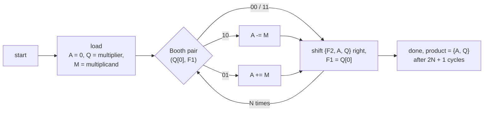

# Booth multiplier: three sign-handling architectures, each with an exactly predicted failure set

[](https://github.com/r800360/booth-multiplier-sv/actions/workflows/ci.yml)
[](LICENSE)

A parameterized, fully synchronous radix-2 Booth multiplier (N × N → 2N bits, two's complement) in SystemVerilog.
It comes in three architectures that differ only in how the partial sum's sign is kept. For each one, a short
argument predicts **exactly** which operand pairs come out wrong. The prediction is then confirmed by:
* exhaustive simulation of all 2²⁶ pairs;
* unbounded proofs where the architecture is claimed exact;
* counterexamples where it is not.



## The idea

An N-bit accumulator cannot always hold the sign of the partial sum, so a separate bit F2 keeps it. After k steps, the
stored partial sum is `M · x_k / 2^(k−1)`, where x_k is the low k multiplier bits read as a signed number. Since
`|x_k| ≤ 2^(k−1)`, **every partial sum has magnitude ≤ |M|**, and its sign follows from M and the Booth digit.

| Architecture | F2 = | Cells (N = 13) | Predicted wrong products |
|---|---|--:|---|
| **wide** | bit N of an (N+1)-bit adder | 251 | none |
| **narrow** | bit N−1 of an N-bit adder | 243 | exactly multiplicand = −2^(N−1) with multiplier ≠ 0 |
| **sign rule** | multiplicand sign ⊕ subtract (one XOR) | 245 | exactly multiplicand = 0 with multiplier ≠ 0 |
| sign rule + zero detect | the same, forced to 0 for a zero multiplicand | 258 | none |

The narrow adder saves only 8 gates (3 %), and making the sign rule exact again costs more than the wider adder. The
(N+1)-bit adder is the simplest exact design.

## Results

| Check | Result |
|---|---|
| **All 67 108 864 pairs at N = 13**, each architecture (Verilator) | wrong exactly on the predicted pairs: 0, 8 191, 8 191 and 0 |
| Corner, random, timing and robustness tests (Icarus and Verilator) | pass; `done` exactly 2N + 1 cycles after start |
| PDR proofs: wide and zero-detect exact for all operands; narrow exact when multiplicand ≠ −2^(N−1); sign rule exact when multiplicand ≠ 0 | **proved unbounded** for N = 4 and N = 6 |
| The same without the assumption | counterexample, for N = 4 and N = 6 |
| SAT equivalence-checking demo | two equivalences proved; one pair found to differ on exactly 2 inputs |

## Reproduce

Every result comes from a pinned toolchain: Ubuntu 26.04 with Icarus Verilog 12.0, Verilator 5.032 and Yosys 0.52
(see [`scripts/install-tools.sh`](scripts/install-tools.sh)).

```bash
docker build -t booth-multiplier-sv .
docker run --rm -u "$(id -u):$(id -g)" -v "$PWD":/work booth-multiplier-sv make ci     # ~3 minutes
docker run --rm -u "$(id -u):$(id -g)" -v "$PWD":/work booth-multiplier-sv make full   # + exhaustive, N = 6 proofs
```

`build/SUMMARY.md` collects every result. The targets are:
* `lint`, `sim`;
* `exhaustive`: all 2²⁶ pairs per architecture;
* `formal` (N = 4 and 6) and `formal-quick` (N = 4);
* `synth` (N = 8, 13 and 16);
* `equivalence`.

The *CI* workflow runs `make ci` on every push. *Full verification* runs `make full` on demand or for a `v*` tag, and
a tag also publishes a release with all outputs.

## Repository map

```
rtl/booth_mult.sv     the multiplier (parameters N, ARCH, ZERO_DETECT)
tb/                   self-checking testbench, tb_common.svh
formal/               harness with optional operand assumptions, pdr.sh, run_formal.sh (expected outcomes)
equivalence/          SAT equivalence-checking demo (functions.sv, check.sh)
docs/                 DESIGN.md (the bound and each architecture), VERIFICATION.md (every check, tool invocations)
```

Origin: this design began as an assignment in a university digital-design course. This repository is an independent,
fully synchronous SystemVerilog re-implementation with its own analysis and verification.

MIT License, © 2026 Rohan Sachdeva.
